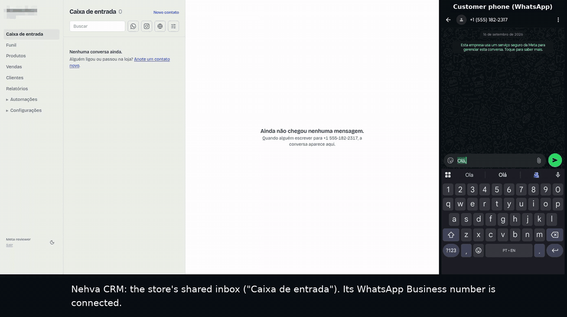
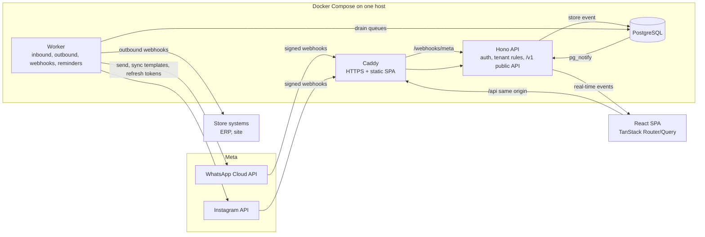

# Nehva CRM: a WhatsApp & Instagram inbox for small stores

> **TL;DR.** Nehva CRM puts a store's WhatsApp, Instagram and website leads in one shared inbox. I designed, built
> and run it solo: a multi-tenant TypeScript backend, a background worker that processes Meta webhooks, and a React
> app. It is a registered Meta Tech Provider, and Meta approved its advanced access to WhatsApp Business messaging
> and management.

*Demo recorded for Meta's app review: a customer message arrives in real time, the team replies, WhatsApp confirms
delivery. Phone number and store name are pixelated.*

## The problem

Small Brazilian stores sell over WhatsApp and Instagram DMs, usually from the owner's phone. Messages get lost
between people. Nobody knows which lead is waiting for an answer. Promotions go out by hand, one by one, and the
number risks getting flagged as spam. Off-the-shelf tools are either built for large call centers or are thin
wrappers that break when Meta changes something.

## What I built

- **One inbox for every channel.** WhatsApp (Cloud API), Instagram DMs (including comment-triggered DMs) and website leads, shared by the
  whole team. A conversation shows who is waiting for an answer and since when.
- **Sales funnel and records.** Contacts and customers, a deal pipeline, a catalog with photos, sales and reports.
- **Agenda.** Appointments with WhatsApp reminders and web push notifications.
- **Automations.** Instagram comment-to-DM automations, and batch sends of approved templates with opt-out handling.
- **Integrations.** A public REST API and outbound webhooks, so a store's ERP can react to new contacts, deals and
  sales.
- **Self-serve onboarding.** Stores connect their own WhatsApp number through Meta's Embedded Signup, including
  coexistence with the WhatsApp Business app on the phone.

## Architecture

The codebase is a TypeScript monorepo:
- `apps/api` (API and worker, one image);
- `apps/web` (a static SPA);
- `packages/contract` (Zod schemas shared by API and web);
- `packages/domain` (pure business rules);
- `packages/db` (Drizzle and PostgreSQL).

## Key technical decisions

**1. From a Next.js monolith to a static SPA plus an API that owns the data.**
The first version was a Next.js app whose pages talked to Postgres directly. That had three problems: the web
process held database credentials, tenant isolation depended on every page remembering to filter by organization,
and SSR plus real-time refreshes caused CPU spikes. I split it:
- a static React SPA with no server code and no credentials;
- a Hono API that is the only owner of the database, auth and tenant rules.

Every API route that takes an id is covered by an isolation test suite: organization A asking for a resource of
organization B gets a 404. The trade-off was a migration of every screen, done in ordered steps with the test suite
green at each one.

**2. Webhooks are stored first and processed later.**
Meta expects a fast 200 and retries aggressively. The API verifies the webhook signature, writes the raw event to an
`inbound_events` table and returns. A separate worker process drains that table. It finds the tenant that owns the
receiving account, applies the message or delivery status, and retries with a bounded attempt count. A slow
dependency never makes Meta drop or duplicate events, and a bug in processing can be fixed and the events replayed.

**3. Outbound webhooks use a transactional outbox.**
When a contact, deal or sale changes, the event row is written **in the same transaction** as the change. So an event
exists if and only if the write was committed. The worker delivers it to each subscribed endpoint, Stripe-style
(several endpoints per store, each choosing its events), and the payload carries the full object, so receivers
don't need to call back.

**4. Protecting the store's WhatsApp number comes before convenience.**
A promotion sent to people who don't want it gets reported. Meta then lowers the number's quality and its daily
limit, and the store loses the channel it uses for everything. So before batch sends shipped:
- a customer replying "SAIR" (Portuguese for "stop") is marked as opted out of offers, with a single automatic
  confirmation;
- Meta's own "stop" delivery error marks the contact the same way;
- marketing templates are blocked for that contact in the UI and in the public API (`409 contact_opted_out`), while
  service messages and normal conversation keep working.

**5. One-command self-hosting.**
`docker compose up` brings up PostgreSQL, the API, the worker and Caddy with automatic HTTPS from a short `.env`
(domain, database password, encryption key). Migrations run before the API starts. Postgres, the API and Caddy
have health checks, and the long-running services restart on failure. Channel tokens are encrypted at rest
with a key from the environment. HTTPS is required anyway, because Meta only delivers webhooks over HTTPS.

## How I built it

I work spec-first with AI coding agents (Claude Code). Each feature starts as a written design, with the trade-offs
and the decisions I made. It then becomes a step-by-step plan, gets implemented by agents under that plan, and goes
through review. The repository keeps dozens of these design docs. Automated tests cover the domain rules, the API
(including tenant isolation) and the web app.

## What I'd do differently

- **Start with the API + SPA split.** The Next.js prototype was fast to start, but the migration cost more than
  building the split from day one would have.
- **Plan Meta's app review from the first week.** Privacy, terms and data-deletion pages, demo videos and permission
  justifications took real calendar time and shaped some features.

## Links

- Product: [app.nehva.online](https://app.nehva.online)
- Full-quality demo video: [assets/demo-inbox.mp4](assets/demo-inbox.mp4)

*The source code is private. Happy to walk through it on a call:
[LinkedIn](https://www.linkedin.com/in/willian-guedes) · willian.wg70@gmail.com.*
